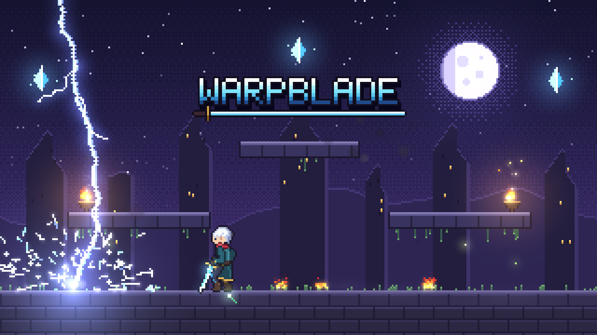
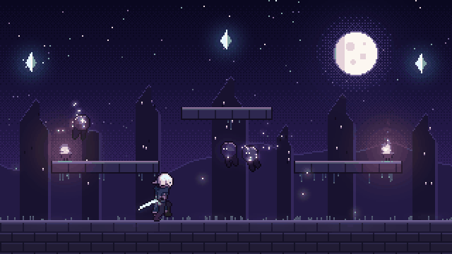
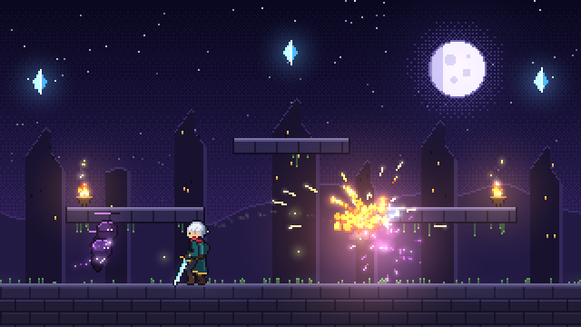
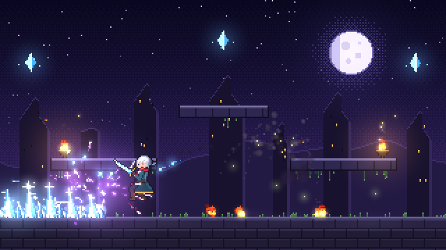
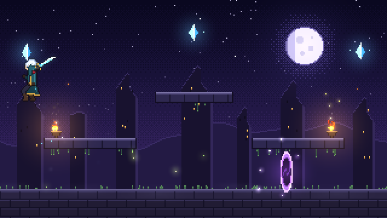

<p align="center">
  <a href="https://warpblade.sainytk.com"></a>
</p>

<p align="center">
  <b>Throw the sword. Become the sword.</b><br>
  A pixel art action game where every sprite and every spark is drawn by code.
</p>

<p align="center">
  <a href="https://warpblade.sainytk.com"></a>
  <a href="LICENSE"></a>
  
</p>

---

## The story so far

The old city fell to the night a long time ago.
Its towers still stand under the moon, and rifts keep opening between them.

Kael is the last warp knight.
His crystal sword can be thrown, and wherever it lands, he follows.

<p align="center">
  
</p>

## Features

- **Earn every ability.** Kael starts a run with his sword, his jump and his dash, and nothing else.
  The warp, each of the three spells and the ultimate are skills learned from picks, and each one's HUD tab appears once it is learned.
- **Warp strike.** Learned with Warp Strike. Throw the sword at a foe and appear beside it mid-swing. The farther you travel, the harder you hit.
  The warp recharges in 2 seconds, far faster than any spell, and the WARP tab beside the element tabs fills back up while it does.
- **Combos that grow.** Two hits at level 1, six by level 17.
  Every hit is its own move: a step-in cut, a rising backhand, a lunging double stab, a hop into a cleave, a turn that cuts both sides and a falling smash that knocks the foe down.
  Each one moves Kael's whole body while his feet stay planted: he rises onto one leg, lunges with his body almost flat, tucks his knees in a hop, spins with his back to you, and unwinds from a turned wind-up into a stance so low his hips nearly touch the floor.
  Only the last hit of a combo, the finishers, and dash and running attacks carry him forward.
  Pick up launchers, sweeps, dash and running attacks, and finishers that cut through a foe to its back or bounce it into the sky.
- **Combos that read the room.** The next hit follows the fight: Kael turns to cut a foe behind him, spins when foes stand on both sides, stabs a foe lying down, leaps after one in the air, and bounces foes off the edge of the stage.
  Air attacks are their own moves: a wheel slash that circles Kael's whole body, a scissor cut that lays him back and sweeps the blade under his feet, and a stomp that drops him feet first and knocks nearby foes down.
  Kael starts with one attack per jump; the two ranks of Sky Dance add the scissor cut and then the stomp.
- **Keen timing.** Press J just after a blow lands and the next one is a sure critical hit with a gold slash.
  Pressing before the blow lands spoils it, so rhythm beats mashing.
- **Positioning pays.** Hits from behind deal 1.5 times the damage and foes in the air take double, with the numbers popping out of every hit.
- **Low health warning.** At a quarter of HP or less, a faint red light glows in from the edges of the screen, and under a tenth it grows wider and beats like a heart. It fades in and out as HP drops or comes back.
  A hurt hero stands wounded when idle: Kael hunches over his sword planted in the floor, and Ysra lets her glaive sag onto the floor ahead, both short of breath.
- **Fights that need skill.** Husks block blows from the front and strike back, wisps slip away from swings, and missed swings leave you open. Dash through an attack at the last moment for a perfect dodge and slow motion.
- **Stamina.** Each dash spends half the green stamina bar, so two dashes in a row leave Kael out of breath until it refills.
  It comes back after a short pause, slower while he attacks, and a perfect dodge gives some back.
  Deep Breath adds a third and then a fourth dash, and Quickstep refills the bar faster.
- **Skill points spent between waves.** Every level up gives a skill point, and when a wave is cleared the fight pauses and three cards offer skills Kael can learn now, each with its own pixel icon. Blade is strong early, Phantom trades power for mobility and crits, Arcane is weak early and strong late. Fusion skills join two paths once both are started: shatter frozen foes, set off burning ones, charge foes by dashing through them, and more. Some skills lock out their rivals for the run, and passives come back until every rank is learned.
  If too few skills are left to fill the cards, Second Wind fills the rest and restores all HP and MP.
- **Evolutions.** A learned skill with its partner passive at full rank evolves from level 6: the next wave pick offers the evolution as a gold first card.
  Fire Flask with Mana Font becomes Sunflask, whose burst throws three smaller flasks that fly at nearby foes and burst on them.
  Ice Spikes with Swift Sigils becomes Glacier Bloom, with a second line of spikes behind Kael and a crown spire that bursts into freezing shards.
  Lightning with Arcane Power becomes Thunderhead, a storm cloud that calls three more bolts on foes beneath it.
  Ysra's Flame Pillar with Kindling becomes Pyre Colonnade, a hotter pillar with two more bursting up on either side a moment later.
  The cards of a skill and its partner say what they evolve into, and an evolved skill's HUD tab gets a gold top edge.
- **Charged ultimates.** Crystal Nova, the weakest, can be learned from level 3; stronger ones replace it: a storm of blades, a legion of phantoms, falling stars or a lightning tempest.
  Hold U through four levels; level 4 spends a full MP bar. After a strike the ultimate recharges for 20 seconds, the longest wait of any ability, and its row on the HUD dims with a bar filling under it.
- **Experience to pick up.** Slain foes drop lime orbs of experience that bounce on the floor. Walk over them to collect them; any left behind fly to the hero after 4 seconds, or in a room to the nearest standing hero.
  Levels take twice the experience they used to, so a full run ends around level 18. Heal and MP orbs drop half as often, so sword hits are the main way to refill MP.
- **Three elements.** Each is its own pick: a flask of fire that sets the floor burning, a running line of ice spikes that freezes, and lightning that arcs to a second foe.
  Each element recharges on its own after a cast, bolt fastest and ice slowest, and every cast makes the other two wait a moment too, so switching elements pays but spamming does not.
  The FIRE ICE BOLT tabs dim while an element recharges, a bar along each tab fills back up, and a press too early is refused with a tick and a jolt of the tab, or a blink of the MP bar when MP is short.
- **Coins and a shop.** Foes drop pixel coins that Kael picks up by touch, and any left behind fly to him after a moment.
  When a run ends, cleared or lost, its coins go to the bank and a result screen shows the wave reached and the coins earned.
  The Shop on the start menu sells stats in levels (HP, attack, ability power, MP, crit, move speed, stamina) and four skills bought once: Lodestone, Warp Shock, Head Start and Last Light.
  Everything bought applies to every run, on top of the level-up picks, and is saved in this browser.
- **Achievements and hero unlocks.** Twenty achievements track goals across runs: waves reached, a clear of wave 10 with each hero, foes slain, long combos, perfect dodges, evolutions, coins banked and the Rift Warden.
  Most pay coins, a few stay hidden as ??? until an earlier one is earned, and a small banner slides down when one is earned without stopping play.
  The Achievements page on the start menu shows what each one asks, with a progress bar for those that count up, and the result screen names those a run earned.
  Kael and Ysra are free; every newer hero is unlocked with coins on the hero screen, each one costing more than the last (see [docs/achievements.md](docs/achievements.md)).
- **Two heroes.** Start opens the hero screen. Kael throws his crystal sword and appears where it lands; he is balanced and learns every ability from picks.
  Ysra, the ember lancer, is a flame-temple guard who woke when the braziers lit again.
  She shares Kael's rig and plays nothing like him: tougher and slower, with one heavy jump and no dash.
  Her glaive string pokes far and pierces every foe in the line, holding `J` winds a lunge, and up or down with `J` hooks a foe up or drags it in.
  `K` pole-vaults over foes on the floor, also straight out of a brace or a backstep, and dives glaive first in the air.
  Holding `L` braces against blows from the front, with a parry for a press just in time that gives stamina back.
  Her blows build Heat, a second bar that pays for fire rites on `I`; MP only pays for her ultimate.
  She starts every run with the whole glaive kit and the Flare rite, and her picks change and extend those moves.
  Her special is Pyre Wave, a wall of flame rolling ahead of her.
  Her three ultimates are Sunspear, a burning spear thrown the length of the stage through every foe in its line; Phoenix Dive, a crash from the sky onto the thickest crowd; and Volcanic Rift, a crack in the floor that erupts in pillars of fire.
  The hero behind the menu changes as you look through the cards, and the choice is saved in this browser.
- **A 30-wave stage in five eras.** The sky and the foes change as the waves go on, and the scene dissolves into the next era between waves.
  Waves 1 to 5 are a sunlit day with Thornbacks, Glimmer Moths and the Oakheart.
  Waves 6 to 10 bring clouds and rain with Mire Toads, Storm Kites and the Bog Hulk.
  Waves 11 to 15 are night with horned husks, floating wisps and the Rift Brute.
  Waves 16 to 20 turn the night magical, with Rune Golems and Prism Sprites taking over from the night's foes.
  Waves 21 to 30 are the darkest, with Void Stalkers, Abyss Eyes and the Abyss Maw.
  Waves 5, 10, 15 and 25 bring the era's mini boss, and the Rift Warden waits at waves 20 and 30.
- **Co-op for up to four.** Co-op on the start menu hosts a room in your browser, and friends join with its five-letter code or an invite link.
  Each player picks a hero, the same hero twice is fine, and a P1 to P4 tag in the player's colour floats over each hero.
  Waves bring more and tougher foes for each extra player.
  Experience is shared, but every player chooses their own skill cards when a wave is cleared and banks their own coins.
  A fallen player is down until the wave is cleared, then rises with half HP; the run ends when everyone is down at once.
  The host's browser runs the game and streams it to the others over WebRTC; [docs/multiplayer.md](docs/multiplayer.md) has the design and its limits.
- **Plays anywhere.** The game fills the whole screen at a whole-number pixel scale, with the scene continued to every edge. Keyboard on desktop, a pixel touch controller on phones and tablets, no install.

<table>
  <tr>
    <td></td>
    <td></td>
    <td></td>
  </tr>
  <tr>
    <td align="center">Fire</td>
    <td align="center">Ice</td>
    <td align="center">Warp</td>
  </tr>
</table>

## Controls

| Key | Action |
| --- | --- |
| `A` `D` or arrows | Walk. Tap a side twice and hold to run |
| `W` or `Up` | Jump, higher the longer you hold it. Hold `S` and jump to drop through a ledge |
| `J` | Sword combo. Each press is a different hit, picked from where the foes are. Combine with `W`, `S`, a jump, a dash or a run for the variants you have learned |
| `L` | Dash. Nothing can touch you while you dash, and each dash spends stamina |
| `K` | Warp strike (10 MP, once learned) |
| `I` | Cast the selected spell (18 MP). Each element then recharges for a few seconds |
| `O` | Switch element: fire, ice, bolt |
| `U` | Hold to charge the ultimate, release to strike (once learned) |
| `M` | Sound on or off |
| `Esc` or `P` | Pause and open the menu |
| `F` | Fullscreen on or off |

On phones and tablets a touch controller appears, in landscape or portrait, and hides again when you press a key.
The stick on the left appears wherever your left thumb lands.
Push it to walk, push it all the way to run, push up to jump and down for the down variants.
The buttons on the right sit in an arc around a large Attack button: Jump, Dash, Warp, Spell, Element and Special.
Several fingers work at once, and a thumb can slide from one button to the next.
Hold Special to charge it: its ring fills one quarter per level, and you strike when you let go.
Buttons dim while their action lacks MP or stamina or waits on a cooldown, and phones that support it give a short vibration on each press.
The page holds still under your fingers: double taps, pinches and long presses never zoom, select text or open a menu.

The game opens on a start menu with Start, Co-op, Shop, Achievements, Controls and Options.
Start opens the hero screen: pick Kael, Ysra or Sable with `A` `D` or the arrows and begin with `J` or `Enter`.
In the Shop, pick an item once to see "Buy?" and again to buy it; a locked hero on the hero screen asks the same way before it is unlocked.
When a run ends, the start menu opens on its result, with Continue and Shop.
Pausing adds Resume, Restart run and Quit run, and freezes the game until you resume.
Move through the menu with the arrow keys or `W` `S`, pick with `J` or `Enter`, and go back with `Esc`; the mouse and touch work too.
The Controls screen lists every key from the game's key map, and on touch screens the stick and buttons as they look on screen.
Options holds sound, volume, screen shake, damage numbers, vibration on devices that can vibrate, and fullscreen, saved in this browser.

Each level up gives a skill point.
When a wave's last foe falls with points waiting, the game pauses and offers three skills for each point.
Choose with `A` `D` or the arrows and learn with `J` or `Enter`, press `1` to `3`, or click or tap a card.
Points left when the last wave of the stage falls are not spent, since the stage ends there.

## Patch notes and feedback

Every update is written up on the [patch notes](https://warpblade.sainytk.com/patches/) page, with the reason behind each change.
Report a bug, a balance problem or an idea through the [game feedback form](https://github.com/SainyTK/warpblade/issues/new?template=game-feedback.yml) on GitHub, and give a thumbs up to [what other players asked](https://github.com/SainyTK/warpblade/issues?q=label%3Agame-feedback).
The studio reads new feedback every night, replies on the issue, and closes it when a patch addresses it, or explains why it will not.
Both are linked from the start menu.

## Run it locally

```sh
npm install
npm run dev
```

Other commands: `npm run build`, `npm run preview`, `npm run typecheck`, `npm run lint`, `npm run format`.

The stack is TypeScript, Vite and Biome.
The only runtime dependencies are three web fonts and [PeerJS](https://peerjs.com), which loads only when a player hosts or joins a room.

To pose Kael, draw effects and hand them to Claude Code agents, run the local [studio](studio/README.md).

## How the pixels are made

This game is also my sandbox for learning how to make pixel art and effects that look good.
There are no image files in the game: the hero, the enemies, the stage and every effect are drawn pixel by pixel at runtime.

The stage is 320 by 180 art pixels, scaled up by a whole number so every pixel stays square.
The frame itself is drawn at twice that, 640 by 360, so the heroes and the effects can carry detail half an art pixel fine.
The stage, the foes and the text keep whole art pixels.
Around the stage, the sky, ridge and stone floor are continued on the same pixel grid and fade out at the edges, so there is no frame.
Each frame is drawn into two buffers, as in Sprite Fusion's effects:

- a color buffer for opaque pixels, faded with a 4 by 4 Bayer dither, or truly blended for smoke and mist;
- a light buffer for additive glow, kept per art pixel and composited on top.

The rules I took from the references, and where they show up:

- Build effects from lines, rims, sparks and light, not flat fills. The slash is a crescent that whips out white at the rim and cools down a blue ramp as its tail follows (`src/game/effects/slash.ts`).
- Put light everywhere. Hits, spells and pickups add lights that flare and fall away with life squared (`src/engine/lights.ts`).
- Use real motion. Sparks stretch with speed and bounce, smoke swells and thins, fire cools down its ramp into smoke, shards tumble and settle (`src/engine/particles.ts`).
- Choreograph in phases: gather, release with a white flash, spread, linger, fade. The lightning bolt marks its target before it strikes, and the ice spikes erupt one after another, stand, then shatter.
- Give every blow an act. Each attack winds up the opposite way, snaps to a new silhouette on the hit frame, freezes the game for a few hundredths of a second on contact, shakes the screen and follows through (`src/constants/clips/`).

Kael is drawn from a small skeleton every frame (`src/game/hero/drawHero.ts`).
His spine runs from hip to neck through a chest point that a pose can push forward or back, so he can lean flat into a lunge, arch under a raised blade or hunch into a wind-up.
A pose can also turn his back to the camera or mirror him to face behind, which is how the spins read as spins.
Arms and legs are placed by two-bone reach, each elbow can bend either way, and each boot tilts to point the toes or rock onto the heel.
The heroes are drawn at the frame's finer grid: each part is lit from the top left with a light edge and a shadow edge, plate armour carries a glint, and the head is a 24 by 22 pixel portrait with a lit eye.
Every hero shares this rig and differs by their colours, head art and weapon (`src/constants/characters/`).
Each body part is outlined where it overlaps the one behind it, and the whole figure gets a dark outline.
Every move, action and state is a keyed clip sampled at 30 frames a second, with a pose keyed on nearly every frame; idle, walk, run, hang, charge and the throw wait loop (`src/constants/clips/`).
His scarf and ponytail are verlet ropes, so they trail behind him as he runs and warps (`src/game/hero/chain.ts`).

The README images were captured from the game canvas when it was 320 by 180 and scaled up with nearest-neighbour, so they show the earlier, coarser heroes.

## Project layout

```text
src/
  main.ts          wires everything and runs the 120 Hz loop
  types/           shared types
  constants/       stage layout, palettes, poses and attack keyframes, tuning, key map, touch controller layout, waves, Kael's skills, coin drops and the shop items
  utils/           pure helpers: math, color, seeded random, stats, experience, level-up picks, wave plan, shop prices and save parsing
  engine/          the pixel renderer: frame buffers and painter, particles, lights, sprite canvas
  services/        Web Audio sound effects, saved options, best wave and shop progress in local storage, the Fullscreen API, vibration, the clipboard
    coop/          the PeerJS links of a co-op room's host and guests, and the game stream
  store/           the player's options, the coin bank, shop purchases, unlocked heroes and achievements kept between runs, achievement tracking, and the co-op room as the menu sees it
  game/            the simulation
    coop/          a co-op room: the host's run with every player's hero, the host and guest sessions, player tags
    hero/          poses, drawing, rope physics, combos and moves, dash, warp, ultimate charge, per-step update
    enemies/       every foe's drawing and behavior, one folder per era (day, rain, twilight, abyss; the night foes sit at the top level)
      kinds/       one kind per foe type, the registry the game looks foes up in
    effects/       slash, impact, floor ring, warp line, rift, thrown sword, shadow orb
    spells/        fire, ice, bolt and the explosion they share
    ultimates/     Thousand Edges, Phantom Legion, Starfall, Tempest
  scene/           background, the backdrop around the stage, the order layers are drawn in, and the dissolve between eras
    eras/          one scene per era: palette, sky, decorations, weather and lighting
  site/            the patch notes page and its shared header and shell
  content/patches/ one JSON file per patch, read by the patch notes page
  ui/              HUD, level-up pick, menu, keyboard input, touch controller, stage sizing
    menu/          start and pause menu: main, Shop, Achievements, Co-op and its lobby, run result, Controls and Options screens
    achievements/  an achievement row, its trophy, the earned banner and their styles
    coop/          the co-op line under the pause button
    shop/          one shop row and the shop's styles
studio/            a local tool to pose Kael with the game's rig, draw effects and send them to agents (see studio/README.md)
docs/
  combo-design.md  what the combo takes from Grand Chase and what it leaves out
  meta-progress.md coins, the shop items and the basis for their prices
  achievements.md  the achievements, how they are tracked, hero unlock prices and how a new hero adds its own
  pick-pacing.md   when picks come, how long the skill pool lasts and Second Wind after it
  multiplayer.md   co-op rooms: who runs the game, what crosses the network, downs, picks, coins and what is left for later
  media/           README banner, gameplay GIF and screenshots
```

## References

- Hugo Duprez, [How to make (good) pixel art effects with Claude](https://www.spritefusion.com/blog/how-to-make-good-pixel-art-effects-with-claude)
- Sprite Fusion, [open-source pixel art VFX](https://www.spritefusion.com/pixel-art-vfx)
- [pixelfx](https://github.com/patch-gg/pixelfx), the effect library and authoring guide built on those effects

## License

MIT, see [LICENSE](LICENSE).
The particle kinds, the frame model and the slash crescent are adapted from Sprite Fusion's open-source pixel art VFX, MIT License, Copyright (c) 2026 Hugo Duprez.
