<p align="center">
  <a href="https://warpblade.sainytk.com">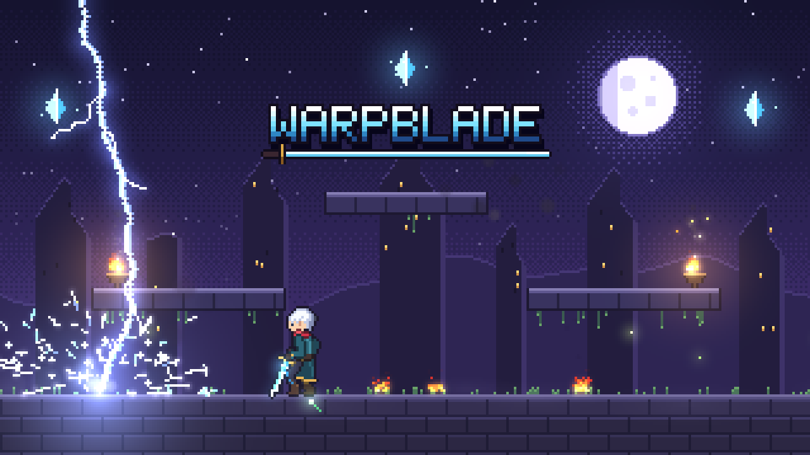</a>
</p>

<p align="center">
  <b>Throw the sword. Become the sword.</b><br>
  A pixel art action platformer: pick a hero, pick a stage, and grow from level 1 to 99 before its boss.
</p>

<p align="center">
  <a href="https://warpblade.sainytk.com"></a>
  <a href="LICENSE"></a>
  
</p>

---

## The story so far

The old city fell to the night a long time ago.
Its towers still stand under the moon, and rifts keep opening between them.

The warp knights set a warp crystal into every sword they forged.
Throw such a sword, and its bearer follows it to wherever it lands.
Kael is the last of the knights, and eight other sword fighters now carry blades with a crystal in them, from a duelist's rapier to a drifter's gun sword.
Eight rifts have torn open across the land, each guarded by a lord that came through it, and behind them all waits the Abyss Citadel.

<p align="center">
  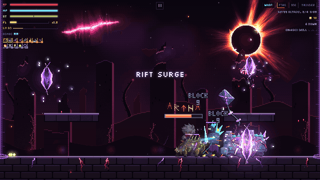
</p>

## Stages

A run is one stage: hold the Warp crystal at its center for 10 minutes.
Choose a hero, then a stage: a new player has the Sunlit Ruins, and every stage you clear opens the next ones.
Your level, skills and skill points start over with each stage, and you grow from level 1 to 99 over its 10 minutes.

| Stage | Mini boss | Boss | Twist |
| --- | --- | --- | --- |
| Sunlit Ruins | Bramble Tusk | Oakheart | Kind Sun: foes hit softer |
| Storm Marsh | The Mire King | Bog Hulk | Swarming Fen: bigger crowds |
| Cinder Foundry | Forge Marshal | The Cinder Smith | Hot Forge: foes hit harder and break sooner |
| Frostglass Caverns | Rime Oracle | Rimeclaw | Hard Ice: foes last longer and hit softer |
| Thunderhead Skyway | Storm Captain | Tempest Roc | Storm Front: faster foes |
| Drowned Archive | Grand Tomeguard | The Pagewyrm | Gilded Pages: twice the elites |
| Moonlit Ruins | Gravewarden | Gloam Shepherd | Gloam Tithe: more gold, fewer hearts |
| Veil Spires | Rift Marshal | Rift Warden | Torn Veil: three times the elites |
| Blightroot Hollow | Rot Queen | Sporeheart | Rot Bloom: no hearts |
| Abyss Citadel | Void Reaver | Abyss Sovereign | Black Sun: faster foes |

The Sunlit Ruins open Storm Marsh and Cinder Foundry, the stages branch from there, and the Abyss Citadel opens once Veil Spires and Blightroot Hollow are both cleared.
Later stages are tougher: foe HP and damage rise by tier, from x1 in the Sunlit Ruins to x3 HP and x1.6 damage in the Citadel.

The hero starts beside the crystal, and the stage stretches several screens to the West and the East.
Foes come through rifts and march on the crystal, and any foe that reaches it strikes it.
They turn on a hero who comes close, so the hero runs from side to side to meet them.
The stage is cleared when the clock runs out with the crystal standing, and lost when the crystal shatters.

The clock sets how strong the foes are and how many come:

- in the first minute and a half they come only from the West;
- then from the West or the East, one side at a time, with a warning before the side changes;
- from minute three and a half, from two sides at once, and flyers from the Sky;
- from minute six, from every side, with foes rising from Below near the crystal and one side surging at a time.

The West sends crowds of weaker foes, the East fewer and tougher ones with more elites, the Sky flyers, and Below foes that rise close to the crystal.
An elite comes at about minute one and a half, the stage's mini boss at about minute four, and its boss at minute seven and a half.
Bosses and mini bosses have three phases, a stagger bar that breaks into a stun, crowd control that wears off faster each time, and an enrage timer.

A fallen hero stands up again at the crystal: after 3 seconds the first time, and a little longer after each fall, up to 30 seconds.

A cleared stage can be bought in Hyper with gold: faster foes, twice the gold, and a reward of its own, such as the stage's Rift Art, which then starts every run.

<table>
  <tr>
    <td>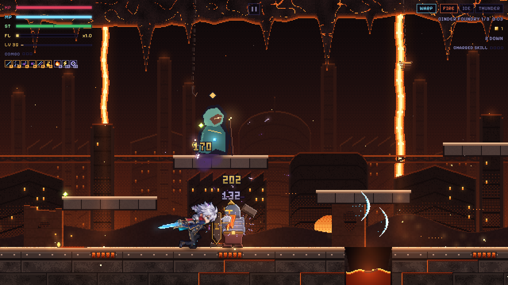</td>
    <td>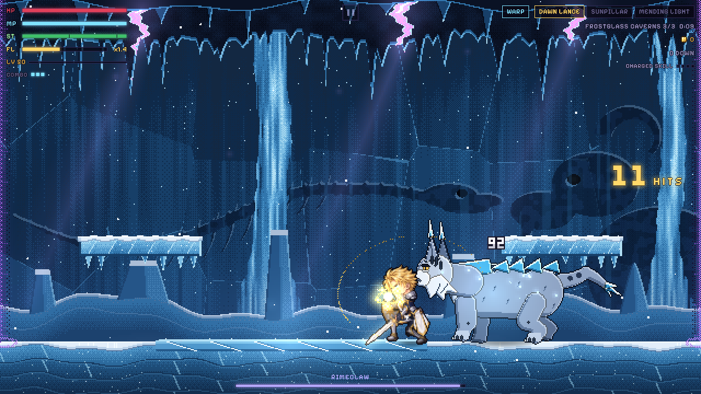</td>
  </tr>
  <tr>
    <td align="center">Cinder Foundry</td>
    <td align="center">Rimeclaw, Frostglass Caverns</td>
  </tr>
  <tr>
    <td>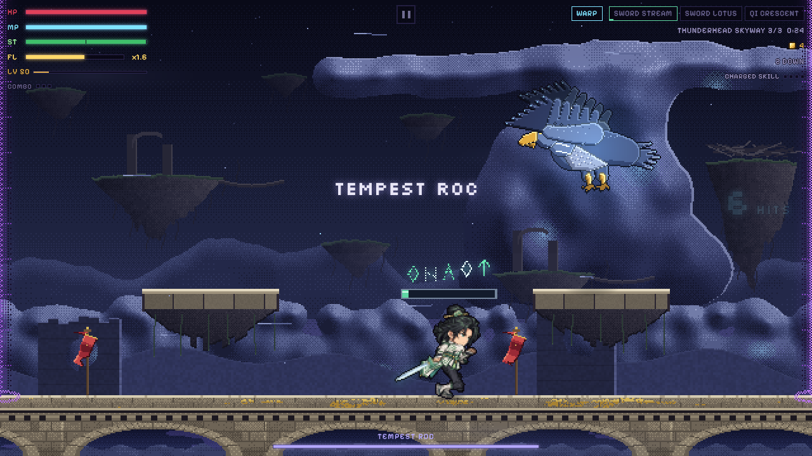</td>
    <td>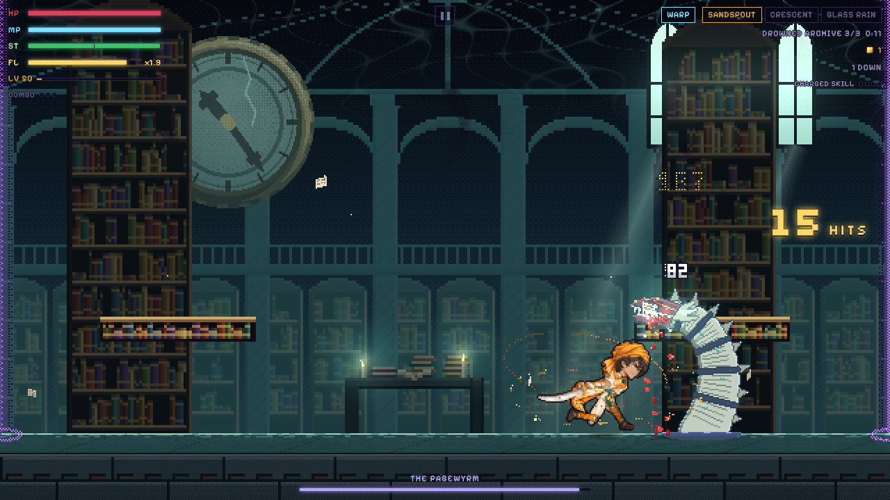</td>
  </tr>
  <tr>
    <td align="center">Tempest Roc, Thunderhead Skyway</td>
    <td align="center">The Pagewyrm, Drowned Archive</td>
  </tr>
  <tr>
    <td>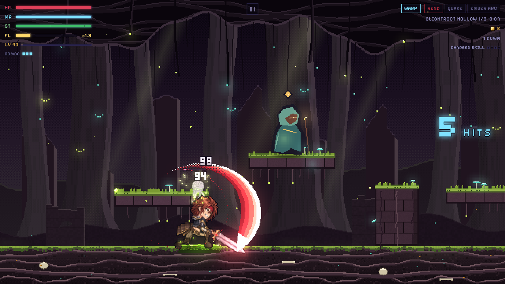</td>
    <td>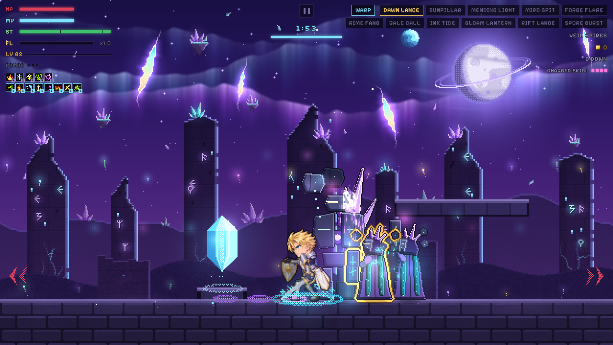</td>
  </tr>
  <tr>
    <td align="center">Blightroot Hollow</td>
    <td align="center">Spire Colossus, Veil Spires</td>
  </tr>
</table>

## Growth: Resonance and Fusions

Every level up to 30 gives a skill point, then every second level, with an extra point at levels 50, 75 and 99.
Points open on one of three cards as soon as you level up: a new skill, the next level of a held skill, or the next level of a Rift Art.

Every skill and every Rift Art belongs to one of five elements: Blaze, Frost, Storm, Venom and Void.
An element's rank is the sum of the levels you hold in it, and every rank adds to every hit you land:

- Blaze burns.
- Frost chills, then freezes, and frozen foes take more.
- Storm arcs to nearby foes.
- Venom poisons, and every poison stack makes the foe take more from everything.
- Void echoes the hit a moment later.

Arcs and echoes are hits too, so they burn, poison and arc again.
A build that leans into two or three elements multiplies its damage, and by the Citadel a good build fills the screen.
Two elements at rank 12 fuse into one of ten Fusions, such as Plasma (Blaze and Storm: arcs set foes burning) or Thunder Echo (Storm and Void: every echo arcs).
At rank 20 an element gains a finishing power, such as Wildfire, where burning foes explode when they fall.
A card says what it adds to your Resonance and when it would complete a Fusion; a Fusion's name stays ??? until you make it once.

<table>
  <tr>
    <td>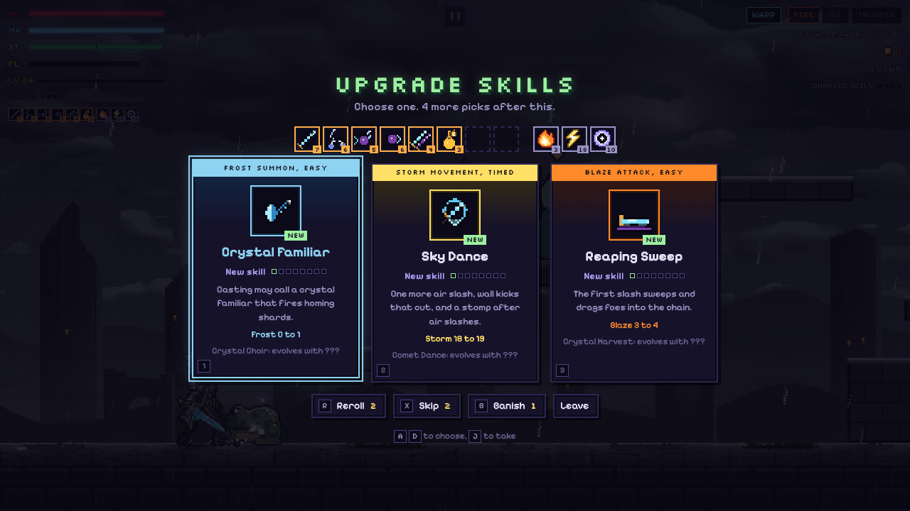</td>
    <td>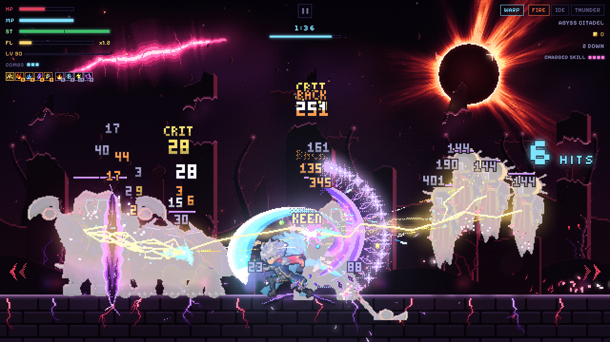</td>
  </tr>
  <tr>
    <td align="center">Cards and Resonance</td>
    <td align="center">A late build in the Abyss Citadel</td>
  </tr>
</table>

When a stage ends, cleared or fallen, the result screen shows your grade, time, level, foes defeated, damage and gold, what the run unlocked, your best run on that stage, and the damage of every source.
A fallen run keeps its gold.
From there, play the stage again, choose another stage, go back to the main menu or visit the Armory.

<p align="center">
  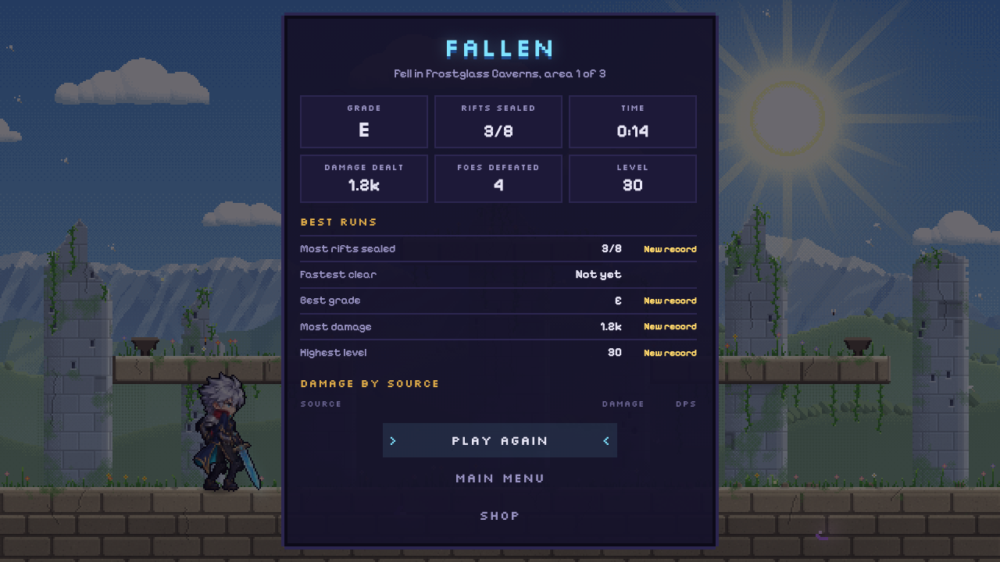
</p>

## Features

- **One moveset for every hero.** Every hero plays on the same buttons and fills them with their own moves.
  `J` chains up to three ground slashes and a jump slash, and held, it charges four tiers of the hero's charged skill (Kael's Crystal Crescent, Rift Spires, Astral Rift and Crystal Nova).
  A bar over the hero fills through the four tier marks and names the tier reached; each tier costs more MP and recharges longer.
  `L` dashes on the ground or once in the air; jump out of a ground dash to carry its speed.
  `U` throws the sword and warp strikes the nearest foe ahead whenever it is ready.
  `K` guards from the front, a tap just before a blow lands parries it and reflects the blow, and `K` during a slash opens an enhanced parry.
  `I` casts the selected spell at once; every spell and Rift Art has its own cooldown and MP cost, and when the selected one is recharging or MP is short, `I` casts the next ready one, so pressing it fast fires several spells in a row.
  `I` during a slash sets the spell into the sword for the next three hits, and that also spends its cooldown and MP.
  `O` cycles the spells: the hero's own three, then every Rift Art earned.
- **Combos that play the same every time.** Each press of J plays one whole blow with a wind-up, a strike that holds through the hit and a follow-through, in the same order wherever the foes stand.
  A swing hits every foe its arc passes through, flyers at head height included.
- **Keen timing.** Press J just after a blow lands and the next one is a sure critical hit with a gold slash.
- **Positioning pays.** Hits from behind deal 1.5 times the damage and foes in the air take double, with the numbers popping out of every hit.
- **Low health warning.** At a quarter of HP or less, a faint red light glows in from the edges of the screen, and under a tenth it grows wider and beats like a heart. It fades in and out as HP drops or comes back.
  A fallen hero drops to one knee on the planted sword before the result screen opens.
- **Fights that need skill.** Many foes guard from the front, flyers dive and shoot, and every attack has a wind-up you can read.
  Parry a blow to take nothing and turn it back, or dash through it at the last moment for a perfect dodge and slow motion.
- **Stamina.** The green stamina bar pays for dodges and blocks.
  Each dodge spends 50, half of Kael's bar, so two dodges in a row leave him out of breath until it refills, and every blow the guard blocks costs some more.
  It comes back after a short pause, slower while the hero attacks, and a perfect dodge or a parry gives some back.
- **Hero skills.** Every hero has 20 skills of their own, each with eight levels, an element and an evolution: attacks, movement, spells, damage over time, summons and one skill that upgrades the charged skill.
  In solo play, level-ups bank skill points without pausing the game.
  A build holds 4 skills at first and up to 8 as levels 15, 30, 45 and 60 open more slots, and every run starts with 2 rerolls, 2 skips and 1 banish to steer the cards.
  A skill at level 8 keeps growing through four mastery levels, and the cards also offer ranks for the charged skill, element attunements and stat cards, so every pick up to level 99 has something to take.
- **Chests and evolutions.** Elites with a gold ring and bosses drop chests in solo play.
  Touch a chest to open it.
  A chest raises held skills and Rift Arts, sometimes three or five at once, and a stage boss's chest always raises at least three.
  Later in a stage a chest can evolve a skill at level 8 whose partner skill is held at level 4 or more.
  Kael's Fire Flask evolves with Crystal Familiar into Sunflask.
  A card says "Evolves with ???" until the player has made that evolution once.
- **Flow.** Every hit of the hero's own adds a stack of Flow, up to 25, each one +4% damage on every source, so a full bar doubles it; a perfect dodge adds five, and getting hurt halves it.
- **Experience to pick up.** Slain foes drop lime orbs of experience that bounce on the floor. Walk over them to collect them; any left behind fly to the hero after 4 seconds, or in a room to the nearest standing hero.
  Attack and ability power grow 2.5% with every level, compounding; levels leave max HP and MP as they are.
- **Heart Shards and Mana Shards.** Max HP and MP grow only from shards: every boss drops a Heart Shard (+3 max HP) and a Mana Shard (+2 max MP), and elites and other foes sometimes drop one.
  Walk over a shard to take it; the HP and MP bars grow longer as shards come in.
- **Drain and regeneration.** Two skills of every hero carry a price: one adds power but drains HP every second, the other regains HP at the cost of MP, or MP at the cost of power.
  The card shows the drain in red and the regeneration in green, and the HUD shows the net HP a second next to the HP bar.
  A drain never takes the last point of HP.
- **Damage by source.** The result screen lists every source of damage with its level, total damage and damage per second: the hero's attacks, abilities and ultimate, each skill that strikes on its own, and each element's Resonance.
- **The Codex.** The Codex on the start menu lists the five elements, the Fusions, the Rift Arts and every hero's skills and evolutions, with Fusions and evolutions not yet made shown as silhouettes with their recipe or ???.
- **Gold and the Armory.** Foes drop pixel coins that the hero picks up by touch, and any left behind fly to them after a moment.
  Runs unlock Armory items through goals; each then costs gold that rises a little with every purchase, refunds in full and can be switched off.
  It sells stats in levels, more rerolls, skips and banishes, Lodestone and Aftershock, and Curse, Greed and Growth, which trade harder foes or more gold and experience.
- **Unlocks.** A new save has Kael, Cerise, five skills each and the Sunlit Ruins; goals such as kills, bosses, levels, gold, Fusions and evolutions open the other heroes, skills, stages and Armory items, and the result screen shows the next goals.
- **Achievements and hero unlocks.** Achievements track goals across runs: bosses reached and beaten, foes slain, long combos, perfect dodges, evolutions, coins banked and The Unblinking.
  Most pay coins, a few stay hidden as ??? until an earlier one is earned, and a small banner slides down when one is earned without stopping play.
  The Achievements page on the start menu shows what each one asks, with a progress bar for those that count up, and the result screen names those a run earned.
  Kael and Cerise are free; every other hero is unlocked with coins on the hero screen, each one costing more than the last (see [docs/achievements.md](docs/achievements.md)).
- **Nine sword heroes.** Start opens the hero screen, a roster of hero tiles over one panel for the hero in focus.
  Every hero fights with a sword that carries a warp crystal, and each plays the shared moveset in their own way:
  - Kael, the warp knight (crystal longsword): casts elemental spells into his sword combo.
  - Cerise, the duelist (rapier): earns Points with Keen thrusts and chains ripostes after a parry.
  - Aldric, the shield knight (arming sword and kite shield): walks in behind a shield that stops every blow and turns blocks into Valor.
  - Vesper, the twin blade (long sword and short sword): gets faster with Tempo and keeps foes in the air.
  - Saya, the quickdraw (katana with scabbard): stores her cuts in foes and releases them all when she sheathes.
  - Yun, the sword sage (jian): spirit swords repeat his blows at range and fly out on his abilities.
  - Brynn, the heavy blade (greatsword): swings through hits with armour and ends her combo in a shockwave.
  - Zafir, the dervish (scimitar): walks through spins that cut both sides and leave bleeding wounds.
  - Calder, the trigger blade (gun sword): fires a round into the wound on a Keen hit and counts the rounds in his chamber.

  Kael and Cerise are open from the start, and the other seven are bought with coins.
  The hero behind the menu changes as you look through the cards, and the choice is saved in this browser.
  A hero with a second job has a JOB row under the stat bars: a locked job shows a padlock and what opens it, and the chosen job sets the portrait, the title and the hero behind the menu.
- **Class advancement.** A hero can grow a second job with its own look, its own end to the string and a new edge on their ultimate.
  Kael is the first: defeat Oakheart with him in a solo run and the Prism Knight opens on the hero screen.
  The Prism Knight wears a pale violet coat with a crystal pauldron and fights in prism light.
  His third blow becomes Prism Thrust, a long lunge that lodges a prism shard in the foe, and his finisher becomes Shatterfall, an overhead cut into the floor that shatters every shard nearby for extra damage.
  His warp, his parry's riposte and his Crystal Nova, which now also fires six prism beams, lodge shards too.
  The Warp Knight, Kael's own job, plays as before, and co-op rooms play every hero's own job.
- **Stage hazards and pits.** Lava vents, falling icicles, wind gusts, poison pools, ink tides, mud vents, grave hands and rift tears, each warned before it strikes.
  Falling into a pit costs some HP and sets you back on firm ground, and foes knocked into one are gone.
  You can pass regular enemies, but defeating them earns experience and helps your grade.
- **Platform movement.** Press Jump during a dash to carry its speed into the air.
  Press Down on a ledge to drop through it.
  Hold toward a wall to slide or hold Jump into it to climb.
  Jump at the wall to rise along it, or steer away as you jump to kick off.
- **Co-op for up to four.** Co-op on the start menu hosts a room in your browser, and friends join with its five-letter code or an invite link.
  Each player picks a hero, the same hero twice is fine, and a P1 to P4 tag in the player's colour floats over each hero.
  Co-op keeps the 30-wave arena and the classic moveset, with more and tougher foes for each extra player.
  Experience is shared, but every player chooses their own skill cards when a wave is cleared and banks their own coins.
  A fallen player is down until the wave is cleared, then rises with half HP; the run ends when everyone is down at once.
  The host's browser runs the game and streams it to the others over WebRTC; [docs/multiplayer.md](docs/multiplayer.md) has the design and its limits.
- **Plays anywhere.** The game fills the whole screen at a whole-number pixel scale, with the scene continued to every edge. Keyboard on desktop, a pixel touch controller on phones and tablets, no install.
  When the window leaves room above the stage, the HUD moves out of the fight: in full on a phone held upright, or compact on either side of the pause button in a small desktop window.
  The spell tabs wrap into rows right of the pause button, so every Rift Art fits.

## Controls

Every hero plays on the same keys in a stage.

| Key | Action |
| --- | --- |
| `A` `D` or arrows | Run |
| `W`, `Up` or `Space` | Jump; hold to jump higher. Press while sliding on a wall to kick away |
| `S` or `Down` | Drop through a ledge |
| `J` | Slash: up to three ground slashes, one in the air. Press again just after a blow lands for a Keen hit |
| `J` held | Charge the hero's charged skill through four tiers, release to strike. Each tier costs more MP and has its own cooldown |
| `L` or `Shift` | Dash on the ground or once in the air |
| `U` | Throw the sword and warp strike the nearest foe ahead |
| `K` | Guard: hold to block from the front, tap just before a blow lands to parry. During a slash, an enhanced parry |
| `I` | Cast the selected spell or Rift Art, or the next ready one when it is recharging or MP is short. During a slash, set it into the sword |
| `O` | Switch to the next spell or Rift Art |
| `M` | Sound on or off |
| `Esc` or `P` | Pause and open the menu |
| `F` | Fullscreen on or off |

Co-op rooms keep the classic moveset: `J` held warps, `L` dodges, `I` casts at once, and `U` charges the ultimate.
The Controls screen lists every key of the mode you are in.

On phones and tablets a touch controller appears, in landscape or portrait, and hides again when you press a key.
The stick on the left appears wherever your left thumb lands.
Push it to walk, push it all the way to run, push up to jump and down for the down variants.
The buttons on the right sit in an arc around a large Attack button: tap it to attack, and hold it to warp.
Around it sit Jump, Dodge, Guard, an ability button that casts on a tap and casts the wide form on a hold, Switch, and Ultimate.
In a stage, holding Attack charges the charged skill, the ability button casts the next ready spell, and the Ultimate button becomes Warp.
Each hero's buttons carry that hero's own names where they differ.
Several fingers work at once, and a thumb can slide from one button to the next.
Hold Ultimate to charge it: its ring fills one quarter per level, and you strike when you let go.
Buttons dim while their action lacks MP or stamina or waits on a cooldown, and phones that support it give a short vibration on each press.
The page holds still under your fingers: double taps, pinches and long presses never zoom, select text or open a menu.

The game opens on a start menu with Start, Co-op, Armory, Achievements, Codex, Controls and Options, and how many stages you have cleared.
Start opens the hero screen: pick a hero with `A` `D` or the arrows and choose it with `J` or `Enter`.
For a hero with jobs, `S` or Down moves to the job row, where `A` `D` or the arrows change the job and `J` or `Enter` chooses; on touch, tap a job's chip, then the panel.
The stage screen follows: look through the stages with `A` `D` or the arrows and begin with `J` or `Enter`; a locked stage names the stages that open it.
`S` or Down moves to the Mode row, where `A` `D` switch between Normal and Hyper, and a Hyper still for sale asks "Buy?" before it spends gold.
`Esc` goes back to the hero screen.
In the Armory, pick an item once to see "Buy?" and again to buy it, and switch a bought item on or off with A and D or its On or Off chip; a locked hero on the hero screen asks the same way before it is unlocked.
When a run ends, its result opens with Play again, Choose stage, Main menu and Armory.
Pausing adds Resume, Restart run and Quit run, and freezes the game until you resume.
Move through the menu with the arrow keys or `W` `S`, pick with `J` or `Enter`, and go back with `Esc`; the mouse and touch work too.
The Controls screen lists every key from the game's key map, and on touch screens the stick and buttons as they look on screen.
Options holds sound, volume, music volume, screen shake, damage numbers, vibration on devices that can vibrate, and fullscreen, saved in this browser.

Level ups give skill points: every level up to 30, then every second level, and one more at 50, 75 and 99.
The skill choices open when you level up.
Leave to keep any points you have not spent; they open again at your next level.
In co-op the cards open for every player with points.
Choose with `A` `D` or the arrows and learn with `J` or `Enter`, press `1` to `3`, or click or tap a card.

## Patch notes and feedback

Every update is written up on the [patch notes](https://warpblade.sainytk.com/patches/) page, with the reason behind each change.
Report a bug, a balance problem or an idea through the [game feedback form](https://github.com/SainyTK/warpblade/issues/new?template=game-feedback.yml) on GitHub, and give a thumbs up to [what other players asked](https://github.com/SainyTK/warpblade/issues?q=label%3Agame-feedback).
The studio reads new feedback every night, replies on the issue, and closes it when a patch addresses it, or explains why it will not.
Both are linked from the start menu.

## Run it locally

```sh
npm install
npm run dev
```

Other commands: `npm run build`, `npm run preview`, `npm run typecheck`, `npm run lint`, `npm run format`.

The stack is TypeScript, Vite and Biome.
The only runtime dependencies are three web fonts and [PeerJS](https://peerjs.com), which loads only when a player hosts or joins a room.

To pose every frame of every hero's moves, run the local [studio](studio/README.md).

## How the pixels are made

This game is also my sandbox for learning how to make pixel art and effects that look good.
Every stage, every foe and boss, the HUD and most effects are drawn pixel by pixel at runtime.
The heroes and some of their skill effects come from generated art atlases (`src/generatedHeroArt/`, `src/effectArt/`), posed on the same rig the code-drawn heroes use, which stays as the fallback.

The viewport is 320 by 180 art pixels, scaled up by a whole number so every pixel stays square.
The frame itself is drawn at twice that, 640 by 360, so the heroes and the effects can carry detail half an art pixel fine.
The stage, the foes and the text keep whole art pixels.
Around the stage, the sky, ridge and stone floor are continued on the same pixel grid and fade out at the edges, so there is no frame.
Each frame is drawn into two buffers, as in Sprite Fusion's effects:

- a color buffer for opaque pixels, faded with a 4 by 4 Bayer dither, or truly blended for smoke and mist;
- a light buffer for additive glow, kept per art pixel and composited on top.

The rules I took from the references, and where they show up:

- Build effects from lines, rims, sparks and light, not flat fills. The slash is a crescent that whips out white at the rim and cools down a blue ramp as its tail follows (`src/game/effects/slash.ts`).
- Put light everywhere. Hits, spells and pickups add lights that flare and fall away with life squared (`src/engine/lights.ts`).
- Use real motion. Sparks stretch with speed and bounce, smoke swells and thins, fire cools down its ramp into smoke, shards tumble and settle (`src/engine/particles.ts`).
- Choreograph in phases: gather, release with a white flash, spread, linger, fade. The lightning bolt marks its target before it strikes, and the ice spikes erupt one after another, stand, then shatter.
- Give every blow an act. Each attack winds up the opposite way, snaps to a new silhouette on the hit frame, freezes the game for a few hundredths of a second on contact, shakes the screen and follows through (`src/heroes/kael/constants/clips/`).

Every hero is drawn from a small skeleton every frame (`src/rig/drawHero.ts`).
The spine runs from hip to neck through a chest point that a pose can push forward or back, so a hero can lean flat into a lunge, arch under a raised blade or hunch into a wind-up.
A pose can also turn the hero's back to the camera or mirror them to face behind, which is how the spins read as spins.
Arms and legs are placed by two-bone reach, each elbow can bend either way, and each boot tilts to point the toes or rock onto the heel.
The heroes are drawn at the frame's finer grid: each part is lit from the top left with a light edge and a shadow edge, plate armour carries a glint, and the head is a 24 by 22 pixel portrait with a lit eye.
Every hero shares this rig and differs by their skin: colours, head art, sword and any item in the off hand (`src/heroes/<id>/look/`).
Each body part is outlined where it overlaps the one behind it, and the whole figure gets a dark outline.
Every move, action and state is a keyed clip sampled at 30 frames a second, with a pose keyed on nearly every frame; idle, walk, run, charge and the throw wait loop (`src/constants/clips/` for the clips every hero shares, `src/heroes/<id>/constants/clips/` for a hero's own).
Scarves, hair tails, capes, sashes and tassels are verlet ropes, so they trail behind the hero as they run and warp (`src/game/hero/chain.ts`).

The README images are captured from the game in a 1280 by 720 window, at four times the art pixels.

## Project layout

```text
src/
  main.ts          wires everything and runs the 120 Hz loop
  types/           shared types
  constants/       stage layout, palettes, the poses and clips every hero shares, tuning, key map, touch controller layout, waves, coin drops, the Armory items and the unlock table
  utils/           pure helpers: math, color, seeded random, stats, experience, level-up picks, wave plan, Armory prices, goal text and save parsing
  engine/          the pixel renderer: frame buffers and painter, particles, lights, sprite canvas
  rig/             the rig every hero is drawn on: pure drawing from a pose and a hero's skin
  heroes/          the roster, and one folder per hero with its stats, look, clips, kit, moves, skills, ultimate, icons and touch art (see docs/hero-module.md)
  stages/          one folder per stage: its layout, scene, foes, boss, Rift Art and hazard, and the registries that read them
  drill/           the stage movement and combat engine every hero plays on: slashes, dash and warp strike, guard and parry, spells and infusion, charged skills
  services/        sound effects and music on Web Audio, saved options, run and stage records, the chosen stage and meta progress in local storage, the Fullscreen API, vibration, the clipboard
    coop/          the PeerJS links of a co-op room's host and guests, and the game stream
  store/           the player's options, the gold bank, the Armory, unlocks and achievements kept between runs, achievement tracking, and the co-op room as the menu sees it
  game/            the simulation
    coop/          a co-op room: the host's run with every player's hero, the host and guest sessions, player tags
    hero/          the moveset every hero shares (warp, guard, dodge, ability bar, ultimate charge), the motion layer, rope physics, the combo engine and the per-step update
    enemies/       every foe's drawing and behavior, one folder per era (day, rain, twilight, abyss; the night foes sit at the top level)
      kinds/       one kind per foe type, the registry the game looks foes up in
    effects/       slash, impact, floor ring, cast ring, warp line, rift, the thrown sword and the shadow orb
    spells/        the explosion that spells share
    ultimates/     the cast every ultimate goes through
    skills/        the skill runtime: events, queries, targeting and precise payoffs
    adventure/     a stage run: the Warp crystal, the clock, the sides foes come from, big foes, revives and hazards
    arts/          Rift Arts as spells in every hero's spellbook, their levels and the boss weaknesses
    resonance/     element procs on every hit, their effects and Fusions
  scene/           background, the backdrop around the stage, the order layers are drawn in, and the dissolve between eras
    eras/          one scene per era: palette, sky, decorations, weather and lighting
  site/            the patch notes page and its shared header and shell
  content/patches/ one JSON file per patch, read by the patch notes page
  ui/              HUD, level-up pick, menu, keyboard input, touch controller, stage sizing
    menu/          start and pause menu: main, Armory, Achievements, Co-op and its lobby, run result, Controls and Options screens
    achievements/  an achievement row, its trophy, the earned banner and their styles
    coop/          the co-op line under the pause button
    armory/        the Armory's rows and styles
studio/            a local tool to pose every frame of every hero's motion clips (see studio/README.md)
docs/
  hero-module.md   how to add a hero: the files it owns, every hook and the checks it must pass
  moveset-design.md the layout every hero shares: the warp, guard and parry, dodge, abilities and ultimate
  combo-design.md  what the combo takes from Grand Chase and what it leaves out
  meta-progress.md gold, the Armory items and their prices
  achievements.md  the achievements, how they are tracked, hero unlock prices and how a hero adds its own
  motion-standard.md the rules every hero's animation follows
  pick-pacing.md   when picks come, how long the skill pool lasts and Second Wind after it
  growth-design.md in-run growth: experience, cards, Resonance, Fusions, Flow and chests
  multiplayer.md   co-op rooms: who runs the game, what crosses the network, downs, picks, coins and what is left for later
  media/           README banner, gameplay GIF and screenshots
```

## Sound credits

Every sound effect and music loop comes from free CC0 packs.
[public/audio/CREDITS.txt](public/audio/CREDITS.txt) lists the source file, pack, author and link for each one.

- Sound effects: [The Essential Retro Video Game Sound Effects Collection](https://opengameart.org/content/512-sound-effects-8-bit-style) by Juhani Junkala, [Impact Sounds](https://kenney.nl/assets/impact-sounds), [Interface Sounds](https://kenney.nl/assets/interface-sounds) and [RPG Audio](https://kenney.nl/assets/rpg-audio) by Kenney, [80 CC0 RPG SFX](https://opengameart.org/content/80-cc0-rpg-sfx), [80 CC0 creature SFX](https://opengameart.org/content/80-cc0-creature-sfx) and [40 CC0 water / splash / slime SFX](https://opengameart.org/content/40-cc0-water-splash-slime-sfx) by rubberduck, and the [Swishes Sound Pack](https://opengameart.org/content/swishes-sound-pack) by artisticdude.
- Music: [4 Chiptunes (Adventure)](https://opengameart.org/content/4-chiptunes-adventure) and [5 Chiptunes (Action)](https://opengameart.org/content/5-chiptunes-action) by Juhani Junkala.

## References

- Hugo Duprez, [How to make (good) pixel art effects with Claude](https://www.spritefusion.com/blog/how-to-make-good-pixel-art-effects-with-claude)
- Sprite Fusion, [open-source pixel art VFX](https://www.spritefusion.com/pixel-art-vfx)
- [pixelfx](https://github.com/patch-gg/pixelfx), the effect library and authoring guide built on those effects

## License

MIT, see [LICENSE](LICENSE).
The particle kinds, the frame model and the slash crescent are adapted from Sprite Fusion's open-source pixel art VFX, MIT License, Copyright (c) 2026 Hugo Duprez.
