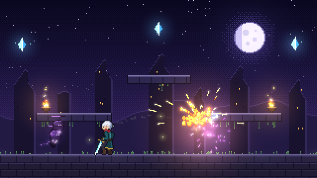
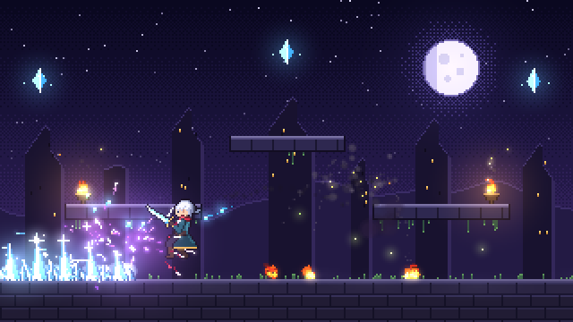
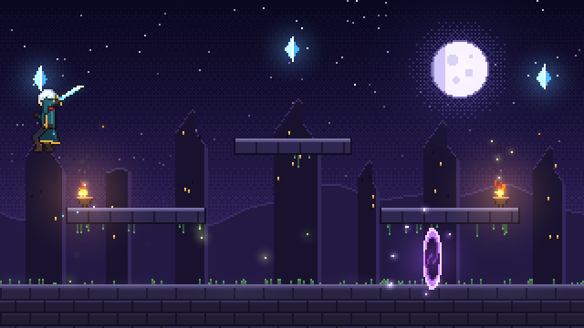

<p align="center">
  <a href="https://warpblade.sainytk.com"></a>
</p>

<p align="center">
  <b>Throw the sword. Become the sword.</b><br>
  A pixel art action game where every sprite and every spark is drawn by code.
</p>

<p align="center">
  <a href="https://warpblade.sainytk.com"></a>
  <a href="LICENSE"></a>
  
</p>

---

## The story so far

The old city fell to the night a long time ago.
Its towers still stand under the moon, and rifts keep opening between them.

The warp knights set a warp crystal into every sword they forged.
Throw such a sword, and its bearer follows it to wherever it lands.
Kael is the last of the knights, and eight other sword fighters now carry blades with a crystal in them, from a duelist's rapier to a drifter's gun sword.
Nine heroes hold the night back together.

<p align="center">
  
</p>

## Features

- **One moveset for every hero.** Every hero plays on the same buttons and fills them with their own moves.
  Tap `J` for the hero's string, and hold it for a quarter of a second to warp: the hero throws their sword at the nearest foe ahead, follows it and strikes on arrival, with the same numbers and the same 10 MP for every hero.
  Hold `K` to guard against blows from the front, and press it just as a blow lands to parry, with a reward of the hero's own.
  `L` is the same front dodge for everyone.
  `I` casts the selected ability, `I` held casts its wide form where it has one, and `O` switches ability.
  `U` is the hero's one ultimate.
- **A full kit from the first second.** Every hero starts a run with every button already doing something.
  Kael has his four-hit sword string, a double jump, Warp Strike on a long press of `J` (throw the sword at a foe and appear beside it mid-swing, harder the farther he travels, 10 MP), a sword guard on `K` whose parry cuts back and lets `J` blink him behind the attacker, the dodge on `L`, and two crystal abilities on `I`, Crystal Lance and Crystal Burst, each with a wide form on a long press.
- **Fixed combo strings.** Each hero's ground string has a fixed length for the whole run, and Kael's has four hits.
  Kael's string is a step-in cut, a rising backhand, a twin-fang double stab and a falling smash that knocks the foe down, and each one moves his whole body while his feet stay planted.
  Skills change what the hits do, never how many there are.
- **Combos that play the same every time.** Each press of J plays one whole blow with a wind-up, a strike that holds through the hit and a follow-through, in the same order wherever the foes stand, and heavy blows bounce foes off the edge of the stage.
  Air attacks are their own moves: a wheel slash that circles Kael's whole body, a scissor cut that lays him back and sweeps the blade under his feet, and a stomp that drops him feet first and knocks nearby foes down.
  Kael has two air attacks per jump, the wheel slash and the scissor cut; the Sky Dance skill adds the stomp.
- **Keen timing.** Press J just after a blow lands and the next one is a sure critical hit with a gold slash.
  Pressing before the blow lands spoils it, so rhythm beats mashing.
- **Positioning pays.** Hits from behind deal 1.5 times the damage and foes in the air take double, with the numbers popping out of every hit.
- **Low health warning.** At a quarter of HP or less, a faint red light glows in from the edges of the screen, and under a tenth it grows wider and beats like a heart. It fades in and out as HP drops or comes back.
  A hurt hero stands wounded when idle: Kael hunches over his sword planted in the floor, short of breath.
- **Fights that need skill.** Husks block blows from the front and strike back, wisps slip away from swings, and missed swings leave you open.
  Press `K` just as a blow lands to parry it: the hero takes nothing, a minion attacker reels, the world slows for a beat, and MP, stamina and Flow come back.
  Dodge through an attack at the last moment for a perfect dodge and slow motion.
- **Stamina.** The green stamina bar pays for dodges and blocks.
  Each dodge spends 50, half of Kael's bar, so two dodges in a row leave him out of breath until it refills, and every blow the guard blocks costs some more.
  It comes back after a short pause, slower while the hero attacks, and a perfect dodge or a parry gives some back.
- **Hero skills.** Every hero has 20 skills of their own, each with eight levels and an evolution: attacks, movement, spells, damage over time, summons and one ultimate skill.
  In solo play, level-ups bank skill points without pausing the game.
  Talk to a mentor to spend each point on one of three cards, or four with luck.
  A card offers a new skill, the next level of a held skill, or the next level of a Rift Art, each with its own pixel icon.
  A build holds up to 8 skills, and every run starts with 2 rerolls, 2 skips and 1 banish to steer the cards.
  If too few cards are left, Second Wind fills the rest and restores all HP and MP.
- **Resonance.** Every skill and every Rift Art belongs to one of five elements: Blaze, Frost, Storm, Venom and Void.
  An element's rank is the sum of the levels you hold in it, and every rank adds to what each of your hits does: Blaze burns, Frost chills and freezes, Storm arcs to nearby foes, Venom poisons and makes foes take more from everything, and Void echoes a hit a moment later.
  Arcs and echoes are hits too, so they can burn, poison and arc again, and a build that leans into two or three elements grows much faster than one spread thin.
  At rank 20 an element gains a finishing power, such as Wildfire for Blaze, where burning foes explode when they fall.
- **Fusions.** Two elements at rank 12 or more fuse into one of ten Fusions, such as Plasma (Blaze and Storm: arcs set foes burning) or Thunder Echo (Storm and Void: every echo arcs).
  A card that would complete a Fusion says so, and a Fusion's name stays ??? until you have made it once.
- **Chests and evolutions.** Elites with a gold ring and bosses before The Unblinking drop chests in solo play.
  Touch a chest to open it.
  A chest raises held skills and Rift Arts, sometimes three or five at once, and from the Bog Hulk onward it can evolve a skill at level 8 whose partner skill is held at level 4 or more.
  Kael's Fire Flask evolves with Crystal Familiar into Sunflask.
  A card says "Evolves with ???" until the player has made that evolution once.
- **Flow.** Every hit of the hero's own adds a stack of Flow, up to 25, each one +4% damage on every source, so a full bar doubles it; a perfect dodge adds five, and getting hurt halves it.
- **Charged ultimates.** Every hero has one ultimate on `U` for the whole run, and Kael's is Crystal Nova.
  Hold U through four levels; level 4 spends a full MP bar.
  After a strike the ultimate recharges for 20 seconds, less with some ultimate skills, and its row on the HUD dims with a bar filling under it.
  Each hero has one ultimate skill, named after their ultimate, that upgrades it level by level and evolves it into a bigger form, such as Supernova for Crystal Nova.
- **Experience to pick up.** Slain foes drop lime orbs of experience that bounce on the floor. Walk over them to collect them; any left behind fly to the hero after 4 seconds, or in a room to the nearest standing hero.
  Attack and ability power grow 2.5% with every level, compounding.
- **Damage by source.** The result screen lists every source of damage with its level, total damage and damage per second: the hero's attacks, abilities and ultimate, and each skill that strikes on its own.
- **The Codex.** The Codex on the start menu lists the five elements, the Fusions, the Rift Arts and every hero's skills and evolutions, with Fusions and evolutions not yet made shown as silhouettes with their recipe or ???.
- **Abilities on `I`.** Each hero turns through their abilities with `O`: their base ones and every spell skill they hold, such as Kael's Fire Flask that sets the floor burning, his Ice Spikes that freeze and his Lightning that arcs to a second foe.
  Each ability has its own recharge, and casting one adds no wait to any other.
  When the selected one is recharging or cannot be paid for, `I` casts the next ready one and selects it; with none ready, the press is refused with a dull tick and a jolt of the tab.
  The HUD tabs dim while an ability recharges, and a bar along each tab fills back up.
- **Coins and a shop.** Foes drop pixel coins that the hero picks up by touch, and any left behind fly to them after a moment.
  When a run ends, cleared or lost, its coins go to the bank.
  The solo results show a grade from E to S, stage progress, bosses defeated, enemies defeated, time and damage dealt.
  The Shop on the start menu sells stats in levels (HP, attack, ability power, MP, crit, move speed, stamina), more rerolls, skips and banishes for the cards, and four skills: Lodestone, Aftershock and Head Start, bought once, and Last Light, bought in three levels, each saving the hero from one more fatal blow per run.
  Everything bought applies to every run and every hero, on top of the level-up picks, and is saved in this browser.
- **Achievements and hero unlocks.** Achievements track goals across runs: bosses reached, a Bog Hulk victory with each hero, foes slain, long combos, perfect dodges, evolutions, coins banked, the Gloam Shepherd, five Bog Hulk kills, the Rift Warden and The Unblinking.
  Most pay coins, a few stay hidden as ??? until an earlier one is earned, and a small banner slides down when one is earned without stopping play.
  The Achievements page on the start menu shows what each one asks, with a progress bar for those that count up, and the result screen names those a run earned.
  Kael and Cerise are free; every other hero is unlocked with coins on the hero screen, each one costing more than the last (see [docs/achievements.md](docs/achievements.md)).
- **Nine sword heroes.** Start opens the hero screen, a roster of hero tiles over one panel for the hero in focus.
  Every hero fights with a sword that carries a warp crystal, and each plays the shared moveset in their own way:
  - Kael, the warp knight (crystal longsword): casts elemental spells into his sword combo.
  - Cerise, the duelist (rapier): earns Points with Keen thrusts and chains ripostes after a parry.
  - Aldric, the shield knight (arming sword and kite shield): walks in behind a shield that stops every blow and turns blocks into Valor.
  - Vesper, the twin blade (long sword and short sword): gets faster with Tempo and keeps foes in the air.
  - Saya, the quickdraw (katana with scabbard): stores her cuts in foes and releases them all when she sheathes.
  - Yun, the sword sage (jian): spirit swords repeat his blows at range and fly out on his abilities.
  - Brynn, the heavy blade (greatsword): swings through hits with armour and ends her combo in a shockwave.
  - Zafir, the dervish (scimitar): walks through spins that cut both sides and leave bleeding wounds.
  - Calder, the trigger blade (gun sword): fires a round into the wound on a Keen hit and counts the rounds in his chamber.

  Kael and Cerise are open from the start, and the other seven are bought with coins.
  The hero behind the menu changes as you look through the cards, and the choice is saved in this browser.
  A hero with a second job has a JOB row under the stat bars: a locked job shows a padlock and what opens it, and the chosen job sets the portrait, the title and the hero behind the menu.
- **Class advancement.** A hero can grow a second job with its own look, its own end to the string and a new edge on their ultimate.
  Kael is the first: defeat Oakheart with him in a solo run and the Prism Knight opens on the hero screen.
  The Prism Knight wears a pale violet coat with a crystal pauldron and fights in prism light.
  His third blow becomes Prism Thrust, a long lunge that lodges a prism shard in the foe, and his finisher becomes Shatterfall, an overhead cut into the floor that shatters every shard nearby for extra damage.
  His warp, his parry's riposte and his Crystal Nova, which now also fires six prism beams, lodge shards too.
  The Warp Knight, Kael's own job, plays as before, and co-op rooms play every hero's own job.
- **A Rift campaign of about 30 minutes.** A solo run starts in the Sunlit Ruins, where Oakheart guards the first rift.
  Then the Rift Map opens: eight Rift stages, played in any order you choose, each with its own place, foes, hazard and boss.
  Storm Marsh (the Bog Hulk), Cinder Foundry (the Cinder Smith), Frostglass Caverns (Rimeclaw), Thunderhead Skyway (the Tempest Roc), Drowned Archive (the Pagewyrm), Moonlit Ruins (the Gloam Shepherd), Veil Spires (the Rift Warden) and Blightroot Hollow (Sporeheart).
  Each stage is three areas, and each area ends in a locked room: a Rift Surge, where rifts keep opening until a crowd of foes has come through, or the stage's boss.
  Stages grow harder with every rift you seal, and your HP and MP fill when you enter one.
  When all eight are sealed, the Abyss Citadel opens: the Abyss Maw, the biggest Surge of the run, the Abyss Sovereign, and what waits after it.
- **Rift Arts.** Every Rift stage's boss leaves its Art behind, a spell every hero can prepare with `I` and cast, or press during a slash to set into the sword.
  Each boss is weak to one other stage's Art, which hits it three times as hard and staggers it, so the order you take the stages in matters.
  Arts level up from cards and chests, and count twice toward their element's Resonance.
- **Stage hazards and pits.** Lava vents, falling icicles, wind gusts, poison pools, ink tides, mud vents, grave hands and rift tears, each warned before it strikes.
  Falling into a pit costs some HP and sets you back on firm ground, and foes knocked into one are gone.
  You can pass regular enemies, but defeating them earns experience and helps your grade.
  Talk to a mentor in an area, or choose Upgrade skills on the Rift Map, to spend your skill points.
- **Platform movement.** Press Jump during a dash to carry its speed into the air.
  Press Down on a ledge to drop through it.
  Hold toward a wall to slide or hold Jump into it to climb.
  Jump at the wall to rise along it, or steer away as you jump to kick off.
- **Co-op for up to four.** Co-op on the start menu hosts a room in your browser, and friends join with its five-letter code or an invite link.
  Each player picks a hero, the same hero twice is fine, and a P1 to P4 tag in the player's colour floats over each hero.
  Co-op keeps the 30-wave arena, with more and tougher foes for each extra player.
  Experience is shared, but every player chooses their own skill cards when a wave is cleared and banks their own coins.
  A fallen player is down until the wave is cleared, then rises with half HP; the run ends when everyone is down at once.
  The host's browser runs the game and streams it to the others over WebRTC; [docs/multiplayer.md](docs/multiplayer.md) has the design and its limits.
- **Plays anywhere.** The game fills the whole screen at a whole-number pixel scale, with the scene continued to every edge. Keyboard on desktop, a pixel touch controller on phones and tablets, no install.
  When the window leaves room above the stage, the HUD moves out of the fight: in full on a phone held upright, or compact on either side of the pause button in a small desktop window.
  It keeps room for a full build and every tab, so only a change of window or hero can move it, never a pick.

<table>
  <tr>
    <td></td>
    <td></td>
    <td></td>
  </tr>
  <tr>
    <td align="center">Fire</td>
    <td align="center">Ice</td>
    <td align="center">Warp</td>
  </tr>
</table>

## Controls

Every hero plays on the same keys.
The table names Kael's moves, and the Controls screen lists each hero's own.

| Key | Action |
| --- | --- |
| `A` `D` or arrows | Walk. Tap a side twice and hold to run |
| `W` or `Up` | Jump or double jump. Jump upward along a wall or steer away to kick off |
| `S` or `Down` | Drop through a ledge in solo play. In co-op, hold and jump to drop |
| `E` | Talk to a mentor in solo play |
| `J` | Sword combo of four blows, the same every time. Press again just after a blow lands for a Keen hit. Just after a parry, blink behind the attacker and strike |
| `J` held | Warp strike: throw the sword at the nearest foe ahead and warp to it (10 MP) |
| `K` | Guard: hold to block blows from the front. Press just as a blow lands to parry with a riposte cut |
| `L` | Dodge forward. Nothing can touch you while you dodge, and each dodge spends stamina |
| `I` | Cast the selected ability: Crystal Lance, Crystal Burst or a spell you learn. If it is recharging, the next ready one goes |
| `I` held | Cast the wide form of the selected ability, for half again the MP |
| `O` | Switch to the next ability |
| `U` | Hold to charge the ultimate, release to strike |
| `M` | Sound on or off |
| `Esc` or `P` | Pause and open the menu |
| `F` | Fullscreen on or off |

On phones and tablets a touch controller appears, in landscape or portrait, and hides again when you press a key.
The stick on the left appears wherever your left thumb lands.
Push it to walk, push it all the way to run, push up to jump and down for the down variants.
The buttons on the right sit in an arc around a large Attack button: tap it to attack, and hold it to warp.
Around it sit Jump, Dodge, Guard, an ability button that casts on a tap and casts the wide form on a hold, Switch, and Ultimate.
Each hero's buttons carry that hero's own names where they differ.
Several fingers work at once, and a thumb can slide from one button to the next.
Hold Ultimate to charge it: its ring fills one quarter per level, and you strike when you let go.
Buttons dim while their action lacks MP or stamina or waits on a cooldown, and phones that support it give a short vibration on each press.
The page holds still under your fingers: double taps, pinches and long presses never zoom, select text or open a menu.

The game opens on a start menu with Start, Co-op, Shop, Achievements, Codex, Controls and Options.
Start opens the hero screen: pick a hero with `A` `D` or the arrows and begin with `J` or `Enter`.
For a hero with jobs, `S` or Down moves to the job row, where `A` `D` or the arrows change the job and `J` or `Enter` begins; on touch, tap a job's chip, then the panel.
In the Shop, pick an item once to see "Buy?" and again to buy it; a locked hero on the hero screen asks the same way before it is unlocked.
When a run ends, the start menu opens on its result, with Continue and Shop.
Pausing adds Resume, Restart run and Quit run, and freezes the game until you resume.
Move through the menu with the arrow keys or `W` `S`, pick with `J` or `Enter`, and go back with `Esc`; the mouse and touch work too.
The Controls screen lists every key from the game's key map, and on touch screens the stick and buttons as they look on screen.
Options holds sound, volume, screen shake, damage numbers, vibration on devices that can vibrate, and fullscreen, saved in this browser.

Each level up gives a skill point.
In solo play, press `E` or tap Talk near a mentor to open skill choices.
Leave to keep any points you have not spent.
In co-op it pauses for pending skill points after a wave.
Choose with `A` `D` or the arrows and learn with `J` or `Enter`, press `1` to `3`, or click or tap a card.

## Patch notes and feedback

Every update is written up on the [patch notes](https://warpblade.sainytk.com/patches/) page, with the reason behind each change.
Report a bug, a balance problem or an idea through the [game feedback form](https://github.com/SainyTK/warpblade/issues/new?template=game-feedback.yml) on GitHub, and give a thumbs up to [what other players asked](https://github.com/SainyTK/warpblade/issues?q=label%3Agame-feedback).
The studio reads new feedback every night, replies on the issue, and closes it when a patch addresses it, or explains why it will not.
Both are linked from the start menu.

## Run it locally

```sh
npm install
npm run dev
```

Other commands: `npm run build`, `npm run preview`, `npm run typecheck`, `npm run lint`, `npm run format`.

The stack is TypeScript, Vite and Biome.
The only runtime dependencies are three web fonts and [PeerJS](https://peerjs.com), which loads only when a player hosts or joins a room.

To pose every frame of every hero's moves, run the local [studio](studio/README.md).

## How the pixels are made

This game is also my sandbox for learning how to make pixel art and effects that look good.
There are no image files in the game: the hero, the enemies, the stage and every effect are drawn pixel by pixel at runtime.

The viewport is 320 by 180 art pixels, scaled up by a whole number so every pixel stays square.
The frame itself is drawn at twice that, 640 by 360, so the heroes and the effects can carry detail half an art pixel fine.
The stage, the foes and the text keep whole art pixels.
Around the stage, the sky, ridge and stone floor are continued on the same pixel grid and fade out at the edges, so there is no frame.
Each frame is drawn into two buffers, as in Sprite Fusion's effects:

- a color buffer for opaque pixels, faded with a 4 by 4 Bayer dither, or truly blended for smoke and mist;
- a light buffer for additive glow, kept per art pixel and composited on top.

The rules I took from the references, and where they show up:

- Build effects from lines, rims, sparks and light, not flat fills. The slash is a crescent that whips out white at the rim and cools down a blue ramp as its tail follows (`src/game/effects/slash.ts`).
- Put light everywhere. Hits, spells and pickups add lights that flare and fall away with life squared (`src/engine/lights.ts`).
- Use real motion. Sparks stretch with speed and bounce, smoke swells and thins, fire cools down its ramp into smoke, shards tumble and settle (`src/engine/particles.ts`).
- Choreograph in phases: gather, release with a white flash, spread, linger, fade. The lightning bolt marks its target before it strikes, and the ice spikes erupt one after another, stand, then shatter.
- Give every blow an act. Each attack winds up the opposite way, snaps to a new silhouette on the hit frame, freezes the game for a few hundredths of a second on contact, shakes the screen and follows through (`src/heroes/kael/constants/clips/`).

Every hero is drawn from a small skeleton every frame (`src/rig/drawHero.ts`).
The spine runs from hip to neck through a chest point that a pose can push forward or back, so a hero can lean flat into a lunge, arch under a raised blade or hunch into a wind-up.
A pose can also turn the hero's back to the camera or mirror them to face behind, which is how the spins read as spins.
Arms and legs are placed by two-bone reach, each elbow can bend either way, and each boot tilts to point the toes or rock onto the heel.
The heroes are drawn at the frame's finer grid: each part is lit from the top left with a light edge and a shadow edge, plate armour carries a glint, and the head is a 24 by 22 pixel portrait with a lit eye.
Every hero shares this rig and differs by their skin: colours, head art, sword and any item in the off hand (`src/heroes/<id>/look/`).
Each body part is outlined where it overlaps the one behind it, and the whole figure gets a dark outline.
Every move, action and state is a keyed clip sampled at 30 frames a second, with a pose keyed on nearly every frame; idle, walk, run, charge and the throw wait loop (`src/constants/clips/` for the clips every hero shares, `src/heroes/<id>/constants/clips/` for a hero's own).
Scarves, hair tails, capes, sashes and tassels are verlet ropes, so they trail behind the hero as they run and warp (`src/game/hero/chain.ts`).

The README images were captured from the game canvas when it was 320 by 180 and scaled up with nearest-neighbour, so they show the earlier, coarser heroes.

## Project layout

```text
src/
  main.ts          wires everything and runs the 120 Hz loop
  types/           shared types
  constants/       stage layout, palettes, the poses and clips every hero shares, tuning, key map, touch controller layout, waves, coin drops and the shop items
  utils/           pure helpers: math, color, seeded random, stats, experience, level-up picks, wave plan, shop prices and save parsing
  engine/          the pixel renderer: frame buffers and painter, particles, lights, sprite canvas
  rig/             the rig every hero is drawn on: pure drawing from a pose and a hero's skin
  heroes/          the roster, and one folder per hero with its stats, look, clips, kit, moves, skills, ultimate, icons and touch art (see docs/hero-module.md)
  services/        Web Audio sound effects, saved options, run records and shop progress in local storage, the Fullscreen API, vibration, the clipboard
    coop/          the PeerJS links of a co-op room's host and guests, and the game stream
  store/           the player's options, the coin bank, shop purchases, unlocked heroes and achievements kept between runs, achievement tracking, and the co-op room as the menu sees it
  game/            the simulation
    coop/          a co-op room: the host's run with every player's hero, the host and guest sessions, player tags
    hero/          the moveset every hero shares (warp, guard, dodge, ability bar, ultimate charge), the motion layer, rope physics, the combo engine and the per-step update
    enemies/       every foe's drawing and behavior, one folder per era (day, rain, twilight, abyss; the night foes sit at the top level)
      kinds/       one kind per foe type, the registry the game looks foes up in
    effects/       slash, impact, floor ring, cast ring, warp line, rift, the thrown sword and the shadow orb
    spells/        the explosion that spells share
    ultimates/     the cast every ultimate goes through
    skills/        the skill runtime: events, queries, targeting and precise payoffs
  scene/           background, the backdrop around the stage, the order layers are drawn in, and the dissolve between eras
    eras/          one scene per era: palette, sky, decorations, weather and lighting
  site/            the patch notes page and its shared header and shell
  content/patches/ one JSON file per patch, read by the patch notes page
  ui/              HUD, level-up pick, menu, keyboard input, touch controller, stage sizing
    menu/          start and pause menu: main, Shop, Achievements, Co-op and its lobby, run result, Controls and Options screens
    achievements/  an achievement row, its trophy, the earned banner and their styles
    coop/          the co-op line under the pause button
    shop/          one shop row and the shop's styles
studio/            a local tool to pose every frame of every hero's motion clips (see studio/README.md)
docs/
  hero-module.md   how to add a hero: the files it owns, every hook and the checks it must pass
  moveset-design.md the layout every hero shares: the warp, guard and parry, dodge, abilities and ultimate
  combo-design.md  what the combo takes from Grand Chase and what it leaves out
  meta-progress.md coins, the shop items and the basis for their prices
  achievements.md  the achievements, how they are tracked, hero unlock prices and how a hero adds its own
  motion-standard.md the rules every hero's animation follows
  pick-pacing.md   when picks come, how long the skill pool lasts and Second Wind after it
  multiplayer.md   co-op rooms: who runs the game, what crosses the network, downs, picks, coins and what is left for later
  media/           README banner, gameplay GIF and screenshots
```

## References

- Hugo Duprez, [How to make (good) pixel art effects with Claude](https://www.spritefusion.com/blog/how-to-make-good-pixel-art-effects-with-claude)
- Sprite Fusion, [open-source pixel art VFX](https://www.spritefusion.com/pixel-art-vfx)
- [pixelfx](https://github.com/patch-gg/pixelfx), the effect library and authoring guide built on those effects

## License

MIT, see [LICENSE](LICENSE).
The particle kinds, the frame model and the slash crescent are adapted from Sprite Fusion's open-source pixel art VFX, MIT License, Copyright (c) 2026 Hugo Duprez.
